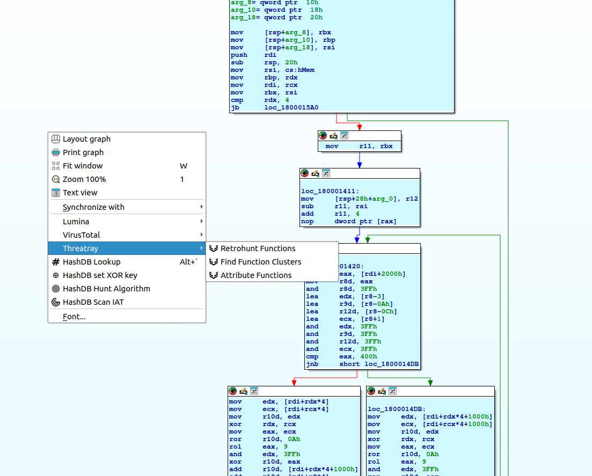
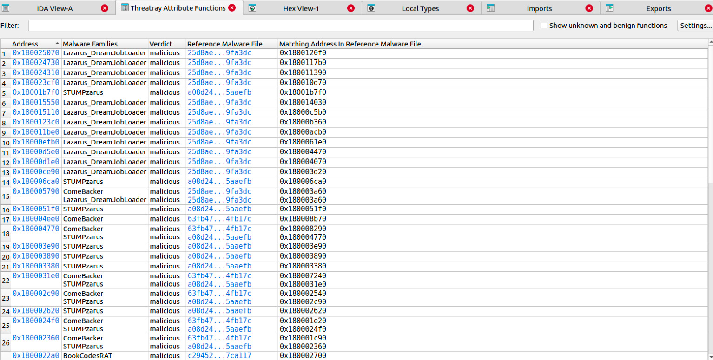
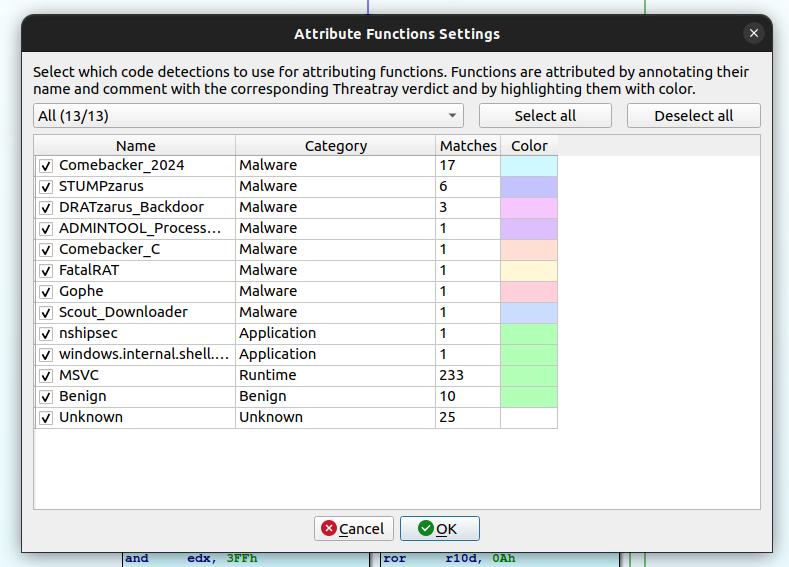
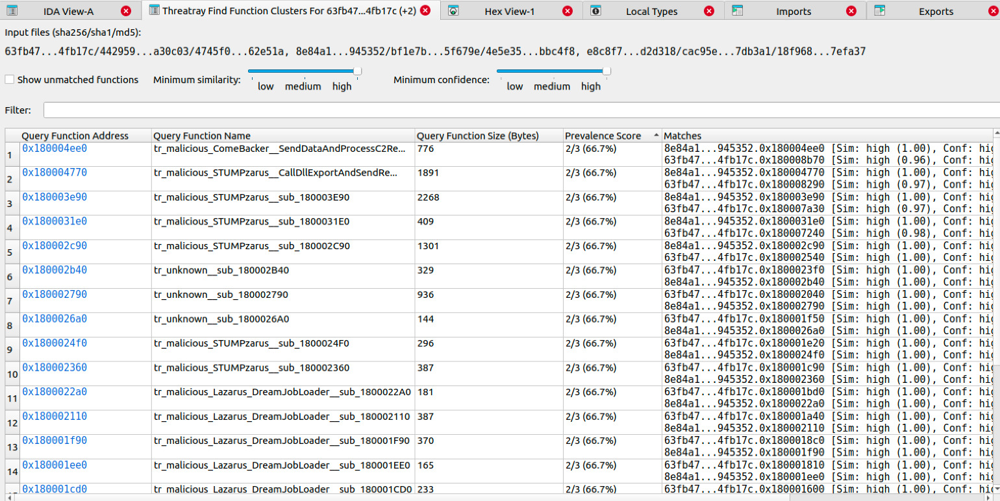
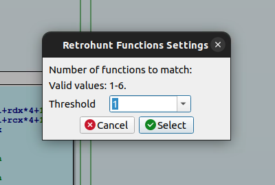
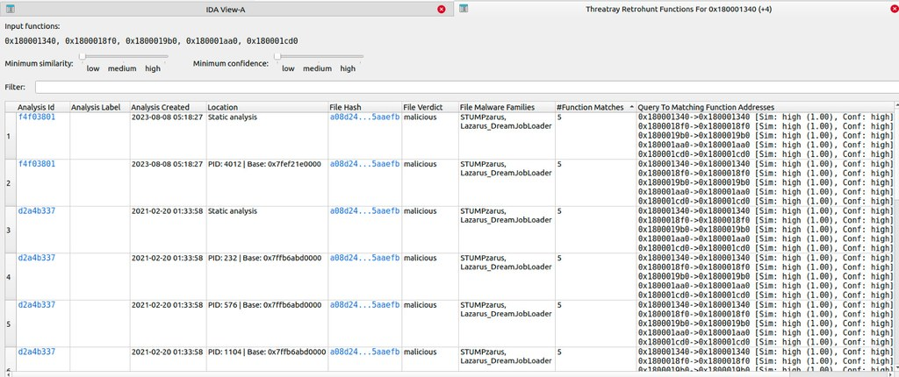

# Threatray IDA Plugin

[](https://github.com/threatray/plugin-ida/actions/workflows/ci.yml)
[](LICENSE)


Use Threatray's code intelligence from inside IDA Pro.

- **Attribute Functions**: see which malware families or libraries the functions of a binary belong to.
  Each function gets Threatray's verdict in its name and comment, and a color.
- **Find Function Clusters**: find functions that several binaries share, and how often they occur in the set.
- **Retrohunt Functions**: find malware and goodware samples that contain functions similar to the ones you select.

## Requirements

- IDA Pro 8.4 or later on Windows, Linux or macOS
- Python 3.10 or later, as used by your IDA
- A Threatray account: you need your **instance name** and an **API key**
- The file you open in IDA must already have been analyzed by Threatray

IDA 9.0 to 9.5 are checked automatically, in real IDA installations, on every change.
If the plugin misbehaves on your version, please [open an issue](https://github.com/threatray/plugin-ida/issues).

## Installation

### IDA 9.0 and later

Install the plugin and its Python dependencies with the Hex-Rays plugin manager:

```
hcli plugin install threatray
```

If you installed the plugin by hand before, first delete `threatray_plugin.py` and the `threatray_ida` folder
from IDA's `plugins` directory.

### IDA 8.4 and 8.5, or installing by hand

1. Download the zip of the [latest release](https://github.com/threatray/plugin-ida/releases/latest) and unpack it.
2. Install the dependencies **with the Python interpreter your IDA uses**:

   ```
   python3 -m pip install -r requirements.txt
   ```

   To find that interpreter, run `import sys; print(sys.prefix)` in IDA's Python console and use the `python`
   in that location, for example
   `C:\Users\you\AppData\Local\Programs\Python\Python312\python.exe -m pip install -r requirements.txt`.
3. Copy `threatray_plugin.py` and the `threatray_ida` folder into IDA's user `plugins` directory:
   - Windows: `%APPDATA%\Hex-Rays\IDA Pro\plugins`
   - Linux and macOS: `~/.idapro/plugins`
4. Restart IDA.

The plugin is tested with Python 3.10, 3.12, 3.13 and 3.14. Your IDA must support the Python version you use.

## First start

The first time IDA loads the plugin, it asks for two things:

- **Instance name**: the first part of the Threatray web app's address after you sign in,
  `https://<instance-name>.analysis.threatray.com`. You can also paste the whole address.
- **API key**: the [authentication guide](https://docs.threatray.com/reference/authentication) explains
  how to get one.

You can change both later under `Edit` > `Plugins` > `Threatray`.

The API key is stored in your operating system's keychain (macOS Keychain, Windows Credential Manager, or the
Secret Service on Linux). Where no keychain is available, it is kept in `threatray/config.json` in the IDA user
directory, readable only by you.

## Usage

Right-click in IDA and open the **Threatray** menu.



A request can take a while. IDA shows a wait box in the meantime, and you can cancel from it.

Every feature opens a result table. In all of them:

- Type in the filter box, or press Ctrl+F (Cmd+F on macOS), to narrow the rows down.
- Double-click an entry, or press Enter, to open it.
- Copy the selected cells with Ctrl+C (Cmd+C), or export the whole table to CSV from the context menu.
- Entries that are links can be copied from the context menu.

### Attribute Functions

Annotates every function with Threatray's verdict: in its name, in a comment, and with a color.
In the settings you choose which detections to apply and their colors.




- Open an `Address` to jump to the function.
- Open a `Reference Malware File` to see the analysis of its first hash in Threatray.
- Select one or more addresses and choose `Retrohunt Functions` from the context menu to search for them.

### Find Function Clusters

Compares the file open in IDA with up to 10 other files, which must also have been analyzed by Threatray,
and shows the functions they share and how often each occurs.

Benign code is left out by default; you can include it in the settings.
For a function with several matches in one file, up to three matches per file are shown.





- Open a `Query Function Address` to jump to the function.
- Select one or more addresses and choose `Retrohunt Functions` from the context menu to search for them.

### Retrohunt Functions

Finds malware and goodware samples with functions similar to the ones you select.

Select one or more functions in the Functions window, or right-click inside a function in the disassembly or
pseudocode view. With several functions selected, you set a threshold: how many of them must match in a file
for it to count as a result.





- With several query functions, `Query To Matching Function Address` lists each match as
  `input function address`->`matching function address`. With one query function, only the matching address
  is shown.
- Open an `Analysis Id` to see the analysis in Threatray.
- Open a `File Hash` to search for the file in Threatray.
- Select one or more file hashes and choose `Find Function Clusters` from the context menu to compare them.

## Troubleshooting

- **The Threatray menu does not appear.** The dependencies are probably installed for a different Python than
  the one IDA uses. Check IDA's Output window for an import error, and repeat step 2 of the manual installation
  with the right interpreter.
- **"Failed to query the threatray API".** Check the instance name and API key under `Edit` > `Plugins` >
  `Threatray`, and that your machine can reach `https://api-<instance-name>.analysis.threatray.com`.
- **"No entity found with the hash".** Threatray has not analyzed the file open in IDA. Submit it first.

## Development

The project is managed with [uv](https://docs.astral.sh/uv/); `pyproject.toml` holds the dependencies and the
configuration of every tool.

```
uv sync                                  # create .venv from uv.lock
uv run ruff check                        # lint
uv run ty check                          # type check
uv run vulture                           # dead code
uv run python tests/unit/run_tests.py    # unit tests
```
